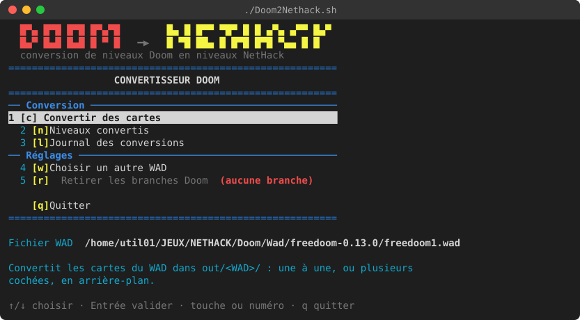
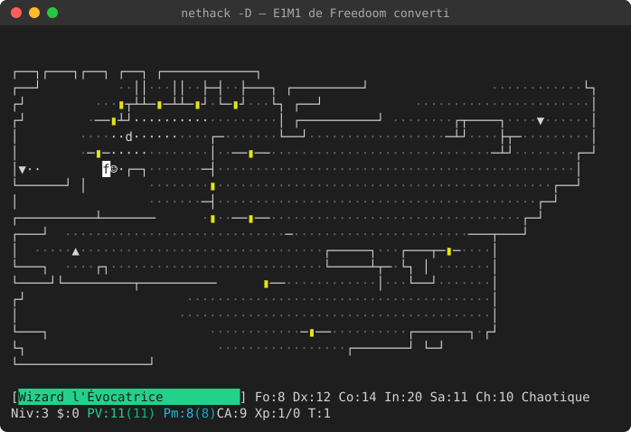

# Doom2Nethack

Convertit un niveau Doom / Doom II (fichier WAD, par exemple produit par
Yadex) en niveau spécial NetHack au format Lua. Les hauteurs sont ignorées :
seule la disposition des salles est conservée. Voir `ANALYSE.md`.

Le prototype est en Python 3, sans dépendance externe.



*Le menu interactif (`./Doom2Nethack.sh`) : conversion des cartes d'un
WAD, niveaux convertis, journal des conversions.*



*E1M1 de Freedoom converti (mode `raster`, options par défaut), chargé dans
NetHack en mode wizard avec la touche `p` du menu. Les zones sombres du
niveau Doom restent dans le noir (sol gris) ; `▮` : portes.*

Ces captures sont des images SVG produites à partir de captures du
terminal (tmux) par `docs/ansi2svg.py` ; son en-tête explique comment les
refaire.

Pour débuter : `TUTORIAL.md`, un tutoriel pas à pas avec le menu
interactif (convertir, regarder et jouer E1M1 de Freedoom, comparer les
deux modes de conversion, découper un grand niveau, convertir un
épisode).

## Charger un niveau Doom dans NetHack

### Prérequis

- NetHack compilé et installé (par défaut dans `~/nh/install/games`), avec
  ses sources configurées (`NETHACK_SRC`, par défaut `../NetHack-5.0.0`,
  à côté du projet, soit ici `/home/util01/JEUX/NETHACK/NetHack-5.0.0`).
- Le mode wizard autorisé : ajouter son nom d'utilisateur à la ligne
  `WIZARDS=` de `~/nh/install/games/lib/nethackdir/sysconf`.
- Un fichier WAD Doom ou Doom II, par exemple Freedoom.
  `python3 doom2nethack.py --list fichier.wad` liste ses niveaux.
- Les WAD sont rangés dans le répertoire des WAD (`WAD_DIR`, par défaut
  `../Doom/Wad`, à côté du projet, soit ici
  `/home/util01/JEUX/NETHACK/Doom/Wad`). Un WAD introuvable depuis le
  répertoire courant y est cherché : `freedoom-0.13.0/freedoom1.wad`
  désigne `$WAD_DIR/freedoom-0.13.0/freedoom1.wad`, d'où qu'on lance
  les commandes.

### Un niveau Doom → un niveau NetHack

1. Convertir et installer le niveau :

   ```sh
   ./convertDoom2Nethack.sh freedoom-0.13.0/freedoom1.wad E1M1
   ```

   Le script affiche la carte obtenue et copie `out/freedoom1/e1m1.lua`
   dans le répertoire de jeu.
2. Lancer NetHack en mode wizard : `~/nh/install/games/nethack -D`.
3. Descendre au niveau 3 : `Ctrl-V`, `3`, `Entrée`. Au niveau 1, NetHack
   refuse de créer l'escalier montant.
4. Charger le niveau : `#wizloaddes`, `Entrée`, `e1m1`, `Entrée`.
5. Afficher toute la carte : `Ctrl-F`.

### Un grand niveau Doom → une branche de plusieurs niveaux

1. Convertir et installer la branche (`-n auto` choisit le nombre de
   niveaux, `-n 3` l'impose) :

   ```sh
   ./convertDoom2Nethack.sh -n auto freedoom-0.13.0/freedoom1.wad E1M1
   ```

   Après confirmation, le script déclare la branche « Doom E1M1 » dans
   `dat/dungeon.lua`, reconstruit l'archive `nhdat` et copie les niveaux
   (`e1m1a.lua`, `e1m1b.lua`…) dans le répertoire de jeu.
2. Commencer une **nouvelle** partie en mode wizard :
   `~/nh/install/games/nethack -D`. Une partie sauvegardée garde l'ancien
   plan du donjon.
3. Aller dans la branche : `Ctrl-V`, `?`, `Entrée`. Le menu liste
   « Doom E1M1 » et ses niveaux ; choisir la lettre de `e1m1a`. Sans
   téléportation, l'escalier de la branche se trouve entre les niveaux 2
   et 4 du donjon principal.
4. Passer d'un niveau au suivant par l'escalier `>` : on arrive sur le `<`
   du niveau suivant, de l'autre côté du passage Doom.
5. Pour retirer les branches Doom : `./convertDoom2Nethack.sh --restore`.

### Avec le menu interactif

```sh
./Doom2Nethack.sh freedoom-0.13.0/freedoom1.wad
```

Le script vérifie que Python 3 et son module `curses` sont présents, puis
lance `Doom2Nethack.py` (qu'on peut aussi lancer directement). Comme
`convertDoom2Nethack.sh`, il tient compte des variables `HACKDIR`,
`NETHACK` et `WAD_DIR`. Sans argument, le menu reprend le dernier WAD utilisé (ou propose d'en
choisir un). L'interface est en couleurs (8 couleurs standard, thème
dans `App.init_theme()` de `d2n/tui.py`) ; dans un terminal sans
couleurs, elle se rabat sur le gras et la vidéo inverse. Il affiche le
fichier WAD utilisé et offre deux menus principaux :

- **Convertir des cartes** : liste les cartes du WAD ; `Entrée`
  convertit la carte choisie dans `out/<WAD sans .wad>/` (par exemple
  `out/freedoom1/e1m1.lua`, ou `out/freedoom1/e1m1/` pour une branche) et
  affiche le résultat. Les cartes déjà converties sont marquées. `Espace`
  coche des cartes et `a` les coche toutes : `Entrée` les convertit
  alors l'une après l'autre. Les conversions se font en arrière-plan : le
  menu reste utilisable, la barre du haut montre leur progression et les
  cartes en cours ou en attente sont marquées. `l`, depuis n'importe quel
  écran, ouvre le journal des conversions : résultat de chacune
  (`Entrée` : détails, `r` : résumé de toutes), `x` arrête celles en
  cours et en attente. Quitter le menu les arrête aussi, après
  confirmation. `o` ouvre
  l'écran des options : mode, découpage (1 à 12 niveaux ou `auto`),
  difficulté, sols à dégâts, seuil de lumière, nombre de salles visé,
  largeur et hauteur de la carte, échelle uniforme et couverture. Les plus
  courantes ont un raccourci : `m` mode (`raster`/`rooms`), `n` découpage
  (1 à 4 niveaux ou `auto`), `s` difficulté, `h` sols à dégâts. Les
  options sont gardées d'une session à l'autre (`out/.options.json`) ;
  `Valeurs par défaut`, en bas de l'écran des options, les réinitialise.
  `c`
  compare la conversion enregistrée de la carte (A) à une conversion
  avec les options actuelles (B), non enregistrée : côte à côte si le
  terminal fait au moins 160 colonnes, sinon l'une après l'autre
  (`Espace`). Le curseur est commun aux deux cartes, ce qui montre ce que
  devient une même case d'une conversion à l'autre. `g` garde B à la
  place de A.
- **Niveaux convertis** : les niveaux de `out/`, classés par section, une
  par fichier WAD. Chaque niveau indique s'il est installé dans NetHack :
  copié dans le répertoire de jeu (et identique), et, pour une branche,
  déclaré dans `dat/dungeon.lua` (« installé, autre version » : le
  fichier copié diffère, par exemple une carte du même nom d'un autre
  WAD). `Entrée` affiche la carte en couleurs (murs, portes en jaune, eau
  en bleu, lave en rouge, escaliers, monstres en rouge — soulignés s'ils
  sont invisibles —, objets en cyan, zones sombres grisées ;
  `Page↑` `Page↓` : niveaux d'une branche). Un curseur se déplace avec
  les flèches (`Maj` + flèche : 8 cases) ; `Tab` et `Maj-Tab` sautent au
  monstre ou à l'objet suivant ou précédent. Au-dessus de la carte
  s'affiche la case sous le curseur : monstre NetHack (invisible,
  endormi) et monstre Doom d'origine, objet et objet Doom d'origine,
  escalier, terrain, état de la porte, zone sombre. Par exemple :
  `(50,12) monstre : wolf (invisible) ← Doom : spectre — sur : sol`.
  `i` l'installe dans NetHack, `x` la supprime, `p` lance NetHack en mode
  wizard directement sur le niveau (voir ci-dessous). Un niveau simple
  est copié dans le répertoire de jeu ; une branche est installée par
  `convertDoom2Nethack.sh` avec les options de sa conversion (gardées dans
  `out/<WAD>/doom2nethack.json`).

#### Jouer un niveau depuis le menu (`p`)

NetHack est lancé en mode wizard (`nethack -D`). On répond soi-même aux
questions du début de partie (personnage, tutoriel) ; dès que la carte
s'affiche, le menu tape à votre place les touches qui mènent au niveau,
puis vous rend la main :

- niveau simple : `Ctrl-V` `3` (téléportation au niveau 3), `#wizloaddes`
  et le nom du niveau, puis `Ctrl-F`. Le niveau est d'abord copié dans le
  répertoire de jeu s'il n'y est pas (après confirmation) ;
- branche : `Ctrl-V` `?`, choix du premier niveau de la branche dans le
  menu de téléportation, puis `Ctrl-F`. La branche doit être installée
  (`i`).

Les `--More--` (`--Plus--`) sont fermés automatiquement. Les invites sont
reconnues en anglais et en français. En mode wizard, le personnage
s'appelle toujours `wizard` : une partie `wizard` sauvegardée est
reprise, puis téléportée au niveau. En fin de partie (ou après `S` pour
sauvegarder), on revient au menu. Hors du menu :
`python3 -m d2n.play e1m1` ou `python3 -m d2n.play --branch e1m1a`.
`D2N_PLAY_LOG=fichier` enregistre les touches envoyées, pour le
débogage.

`Journal des conversions` ouvre le journal (comme `l`).
`Choisir un autre WAD` ouvre un explorateur de fichiers. Il
liste d'abord les 10 derniers WAD utilisés (`x` en retire un de la
liste, gardée dans `out/.recent-wads.json`), puis le contenu du
répertoire du WAD utilisé (sans WAD : le répertoire des WAD). `w` va au
répertoire des WAD, `/` permet de saisir un chemin (absolu, relatif au
répertoire affiché ou commençant par `~`), avec complétion par `Tab`.
`Retirer les branches Doom` lance
`convertDoom2Nethack.sh --restore` (le script demande confirmation).
Navigation : flèches, `Page↑`/`Page↓`, `Entrée`, `q` ou `Échap` pour
revenir.

### Commandes utiles dans le jeu

| Touche      | Effet                                                    |
|-------------|----------------------------------------------------------|
| `Ctrl-F`    | révéler toute la carte (mode wizard)                     |
| `Ctrl-V`    | se téléporter à un niveau (`?` : menu des niveaux)       |
| `_`         | aller automatiquement à un endroit (par exemple `>`)     |
| `;`         | regarder un monstre ou un objet                          |
| `Ctrl-W`    | souhait : « potion of monster detection » montre les monstres |
| `#quit`     | abandonner la partie (fermer le terminal la sauvegarde)  |

## Utilisation de doom2nethack.py

```sh
python3 doom2nethack.py --list doom2.wad           # niveaux du WAD
python3 doom2nethack.py -p -m MAP01 doom2.wad      # écrit out/doom2/map01.lua
python3 doom2nethack.py -p --keep-aspect -o lvl.lua doom2.wad
python3 doom2nethack.py -p -n auto -m E1M1 freedoom1.wad  # out/freedoom1/e1m1/
python3 doom2nethack.py -p --mode rooms -m E1M1 freedoom1.wad  # salles
```

Options :

| Option                  | Rôle                                                  |
|-------------------------|-------------------------------------------------------|
| `WAD`                   | fichier WAD, cherché aussi dans `WAD_DIR`             |
| `-m`, `--map`           | niveau à convertir (défaut : le premier)              |
| `-o`, `--output`        | fichier de sortie (défaut `out/<wad>/<niveau>.lua` ; `-` : sortie standard) |
| `-n`, `--parts`         | découpe en N niveaux reliés par des escaliers (`auto`) |
| `-d`, `--outdir`        | répertoire d'un niveau découpé (défaut `out/<wad>/<niveau>`) |
| `-p`, `--preview`       | affiche la carte obtenue (avec `<` et `>`)            |
| `--width`, `--height`   | taille de la carte (max 75 × 19)                      |
| `--keep-aspect`         | échelle uniforme au lieu d'étirer la carte            |
| `--samples`             | échantillons par case et par axe (défaut 3)           |
| `--coverage`            | part d'une case à couvrir pour faire un sol (0.34)    |
| `--mode`                | `raster` (plan décalqué, défaut) ou `rooms` (salles et couloirs) |
| `--rooms`               | mode `rooms` : nombre de salles visé (défaut 12)      |
| `--hazards`             | sols à dégâts : `none` (défaut), `water` ou `lava`    |
| `--dark-below`          | lumière Doom (0-255) en dessous de laquelle une zone est sombre (144 ; 0 : tout éclairé) |
| `--skill`               | difficulté des things : `easy`, `medium` (défaut), `hard` |

## Fonctionnement de convertDoom2Nethack.sh

- Un seul niveau : le `.lua` est copié dans le répertoire de jeu (HACKDIR,
  par défaut `~/nh/install/games/lib/nethackdir`). Un fichier absent de
  l'archive `nhdat` y est cherché (`dlb_fopen()`, `src/dlb.c`), d'où
  `#wizloaddes` le charge.
- Branche (`-n`) : la branche est déclarée dans `dat/dungeon.lua` des
  sources NetHack (blocs entre marqueurs `doom2nethack:begin/end`, remplacés
  à chaque exécution), l'archive `nhdat` est reconstruite par `make dlb` et
  copiée dans HACKDIR, avec les `.lua`. Les originaux sont gardés en
  `*.doom2nethack.orig`. `make install` n'est pas utilisé : il efface
  HACKDIR (parties sauvegardées, `record`, `sysconf`).
- `NETHACK_SRC`, `HACKDIR`, `OUTDIR` et `WAD_DIR` permettent de changer
  les chemins ;
  les options `--skill`, `--hazards`… sont passées à `doom2nethack.py`.

## Deux modes de conversion

- `raster` (défaut) : une grille de 75 × 19 cases est posée sur le plan
  Doom ; chaque case est du sol si elle tombe dans un secteur. Fidèle à la
  forme des pièces, mais les détails sont écrasés par la compression.
- `rooms` : on garde quelles salles existent et lesquelles communiquent,
  puis on redessine un niveau à la manière de NetHack (`d2n/rooms.py`) :
  1. les secteurs sont regroupés en salles : un secteur presque entouré par
     un autre (flaque, estrade) ou très petit (marche, bande de lumière) est
     fusionné avec son voisin, puis les salles les plus liées sont
     fusionnées jusqu'au nombre visé (`--rooms`, 12 par défaut) ;
  2. les groupes longs et étroits deviennent des couloirs, les secteurs
     porte des portes : ce sont des passages, pas des salles ;
  3. chaque salle devient un rectangle placé à la position projetée de son
     centre Doom, de taille proportionnelle à son emprise, puis les
     rectangles sont écartés jusqu'à laisser un passage entre eux (moins de
     salles si elles ne tiennent pas) ;
  4. les salles reliées dans Doom, directement ou par des couloirs et des
     portes, sont reliées par des couloirs `#`, avec une porte à chaque
     bout (`+` pour une porte Doom, ouverture sans porte sinon) ;
  5. les secteurs inaccessibles depuis le départ (décors vus par une
     fenêtre, placards à monstres) sont retirés ; les téléporteurs comptent
     pour l'accessibilité. Une salle accessible mais non reliée est
     raccordée à la plus proche.

  Le niveau est plus lisible et plus « NetHack », mais la forme des pièces
  est perdue (un hall en L devient un rectangle). Les things gardent leur
  position relative dans leur salle.

Les deux modes fonctionnent avec le découpage en plusieurs niveaux.

## Découpage en plusieurs niveaux

Un grand niveau Doom comprimé sur 75 × 19 cases perd ses détails. Avec
`--parts N` (ou `auto`, qui vise des cases d'environ 48 × 96 unités Doom,
12 niveaux au plus), il est découpé en une branche de N niveaux NetHack :

- les secteurs sont répartis par bissections successives le long de l'axe
  le plus comprimé ;
- les morceaux forment une chaîne (un niveau NetHack n'a qu'un escalier
  montant et un descendant) qui commence au départ du joueur et enchaîne de
  préférence des morceaux voisins dans Doom ;
- entre deux morceaux voisins, l'escalier descendant de l'un et l'escalier
  montant du suivant sont placés de part et d'autre du plus large passage
  qui les relie dans Doom ;
- le premier niveau reçoit l'escalier de branche (retour vers le donjon
  principal) au départ du joueur ; l'escalier descendant du dernier niveau
  est ignoré par NetHack (fond de la branche).

Sont produits `<niveau>a.lua`, `<niveau>b.lua`… et `<niveau>-dungeon.lua`,
qui explique comment déclarer la branche dans `dat/dungeon.lua` (ce que fait
`convertDoom2Nethack.sh`, via `python3 -m d2n.dungeon patch|unpatch`). Les
passages entre morceaux autres que la chaîne sont perdus, et la sortie Doom
peut ne pas tomber dans le dernier morceau (avertissement).

En mode wizard, `Ctrl-V` (téléportation de niveau) permet ensuite d'aller
directement dans la branche.

## Ce que fait le prototype

- Rasterisation : chaque case est échantillonnée (3 × 3 par défaut) et
  rattachée au secteur Doom majoritaire (test point-dans-polygone).
- Connectivité : deux secteurs reliés dans Doom par une ligne franchissable,
  directement ou à travers des secteurs trop petits pour apparaître
  (marches, ascenseurs), le sont aussi sur la carte ; un couloir est creusé
  si besoin.
- Portes : une porte (`+`) par secteur porte (linedefs 1, 26-28, 31-34,
  117, 118). Les portes à clé sont verrouillées.
- Escaliers : l'escalier montant est au départ du joueur, l'escalier
  descendant à la sortie (linedefs 11, 51, 52, 124…).
- Monstres et objets : table de correspondance dans `d2n/tables.py`.
- Éclairage : le niveau est éclairé, sauf les cases des secteurs dont la
  lumière Doom est inférieure à `--dark-below` (144 par défaut : les zones
  tamisées à 128 et moins). En mode `rooms`, une salle prend la lumière
  moyenne de ses secteurs, et un couloir celle des salles qu'il relie. Les
  murs qui ne bordent que des cases sombres sont sombres aussi. Les cases
  sombres sont passées à `des.region(selection, "unlit")`.
- Toute zone restée isolée (téléporteurs, sols mobiles, rambardes) est
  reliée à la zone principale : tout le niveau est accessible.

## Tests

```sh
python3 -m unittest discover -s tests
python3 tests/make_test_wad.py test3rooms.wad    # WAD de test à 3 salles
```

Certains tests utilisent des fichiers extérieurs au projet, et sont sautés
s'ils sont absents :

| Variable      | Défaut (à côté du projet) | Utilisé par                     |
|---------------|---------------------------|---------------------------------|
| `WAD_DIR`     | `../Doom/Wad`             | Freedoom (`freedoom-0.13.0/`)   |
| `NETHACK_SRC` | `../NetHack-5.0.0`        | noms des monstres et objets, `dungeon.lua`, menu |
| `YADEX_DIR`   | `../YadexEditor`          | `test.wad` de Yadex             |
